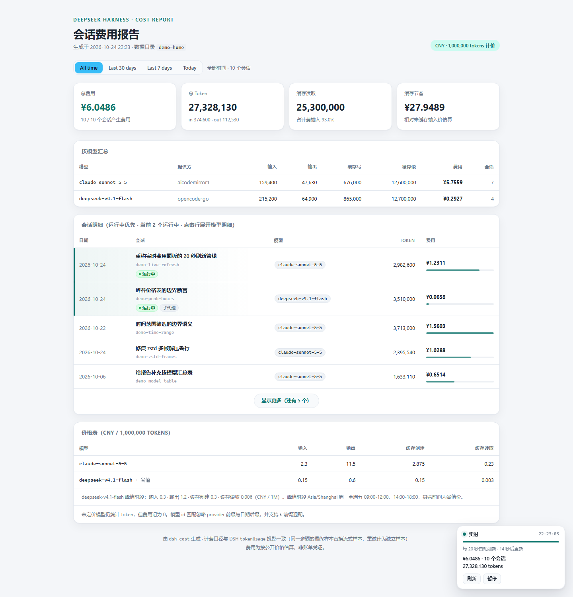

# DSH_CostLive 实时费用面板

一个本地网页，每 **20 秒**重新扫描 DSH 会话日志，实时显示全部会话的 token 用量与人民币费用。
页面复用 `dsh-cost report` 的 HTML 渲染器，所以卡片、表格、配色、交互和原报告**完全一致**，
只在右下角多一个刷新状态浮窗。



页面从上到下依次是：总费用 / 总 Token / 缓存读取 / 缓存节省四张卡片，按模型汇总、会话明细
（点击行展开）、价格表；右下角浮窗显示「实时 / 已暂停 / 连接中断」、数据生成时间、
下次刷新倒计时、费用与会话数，以及「刷新」「暂停」按钮。

会话明细默认只显示前 **5** 行，按「运行中主会话 → 运行中子代理 → 已完成（费用降序）」排序，
运行中的行会高亮；其余会话通过「显示更多 / 收起」展开，实时刷新与 `file:///` 重载都会记住展开状态。

## 三种打开方式

| 方案 | 启动方式 | 地址 | 自动更新 | 适合 |
|---|---|---|---|---|
| **B. 本地 HTTP 服务（推荐）** | 双击 `dsh-cost-live.cmd` | `http://127.0.0.1:4173/` | 每 20 秒拉取 `/api/fragment`，**原地更新**，不丢滚动和展开状态 | 长期开着看 |
| **C. file:/// + 后台重建** | 双击 `dsh-cost-live-watch.cmd` | `file:///<仓库路径>/out/dsh-cost-live.html` | 后台每 20 秒重写 HTML，页面自动重载；滚动和展开状态会保留 | 必须用 `file:///` 打开 |
| 静态快照（不跑后台任务） | 直接双击 `out\dsh-cost-live.html` | `file:///...` | 不更新（两次未变化后自动暂停并提示） | 归档、发给别人 |

> 用 `--once --auto-reload` 或 `--watch` 生成的 `out/dsh-cost-live.html` 默认带「20 秒自动重载」
> 配置：有后台任务重建时它会持续刷新；没有后台任务时，它会在连续两次看到同一快照后暂停并显示
> 黄色提示，不会无限刷新。

> **为什么不能只靠一个 HTML 文件自动更新？**
> 浏览器的安全模型禁止网页启动进程（所以 `file:///` 页面无法执行 `dsh-cost` 命令），
> 也禁止 `file:///` 页面用 `fetch` 读取同目录 JSON。自动更新必须有一个本地进程：
> 方案 B 用本地 HTTP 服务提供 API；方案 C 用后台进程定时重写 HTML，页面只负责重载。
> 生成的独立 HTML 已内置 20 秒刷新逻辑，配合方案 C 的后台任务即可自动更新。

---

## 先用演示数据看一眼（不接触真实会话）

仓库自带一个合成数据生成器，会造出 10 个虚构会话（2 个运行中：一个主会话 + 一个子代理），
写入 `demo-home/`（已在 `.gitignore` 中）：

```powershell
node tools\make-demo-home.mjs
node bin\dsh-cost-live.mjs --home demo-home
# 打开 http://127.0.0.1:4173/
```

演示会话的时间戳相对「现在」生成，所以 Today / 7 days / 30 days 三档都有内容；
随时删除 `demo-home/` 即可清理。README 中的截图就是这套数据渲染出来的。

---

## 同时监测主机与 VMware 里的 DSH

宿主机的面板可以同时读两个 DSH：本机 `~/.dsh` 和 Ubuntu VM 里的 `~/.dsh`。VM 数据通过增量镜像接入，不需要在 VM 上跑服务：

```powershell
# 1) 保持这个窗口打开：每 20 秒增量同步 VM 的 sessions + projcache
dsh-cost-vm-sync.cmd

# 2) 正常启动面板（dsh-cost-live.cmd 已带 --sources config\sources.json）
dsh-cost-live.cmd
```

`config/sources.json`：

```json
{
  "sources": [
    { "label": "主机", "home": "~/.dsh" },
    { "label": "VM", "home": "../../.dsh-vm" }
  ]
}
```

- 镜像默认在 `.dsh-vm/`，只复制 `sessions/` 与 `storages/session_projcache/`，增量传输，已在 `.gitignore` 中。
- VM 关机或未同步时，面板继续显示主机数据，并在顶部提示数据源不可用；同步脚本每 60 秒重试。
- 会话列表、按天视图和模型汇总都会合并两边数据，会话行带「主机 / VM」标签。
- CLI 也支持：`node bin\dsh-cost.mjs --sources config\sources.json`。

---

## 方案 B：本地实时服务（推荐）

### 启动

最简单：在资源管理器里双击

```text
dsh-cost-live.cmd
```

会打开一个控制台窗口并自动打开浏览器；**关掉控制台或按 Ctrl+C 即停止服务**。
也可以从命令行启动：

```powershell
cd DSH_CostLive

# 默认 127.0.0.1:4173，自动打开浏览器
node .\bin\dsh-cost-live.mjs

# 换端口、10 秒刷新、只看 sonnet、不自动开浏览器
node .\bin\dsh-cost-live.mjs --port 8080 --interval 10 --model claude-sonnet-5-5 --no-open

# 包含没有用量记录的会话，只看费用最高的 10 个
node .\bin\dsh-cost-live.mjs --all --top 10
```

启动后控制台会打印实际地址（端口被占用时自动尝试 4174、4175……）：

```text
dsh-cost live · 实时费用面板
  地址   http://127.0.0.1:4173/
  数据   C:\Users\<you>\.dsh
  刷新   每 20 秒（浏览器拉取 /api/fragment）
  会话   9 个 · ¥1.6625 · 52,854,726 tokens
  停止   Ctrl+C
```

### 页面行为

- **每 20 秒**请求一次 `/api/fragment`；服务端重新读取 DSH 会话日志、重新计价并返回报表主体。
- 只替换 `.wrap` 区域，**滚动位置、展开的会话行、价格表都保留**；费用变化时总费用卡片会闪一下。
- 顶部时间范围（All time / Last 30 days / Last 7 days / Today）在每次 fragment 替换后自动重新应用；
  选择存于 `localStorage["dsh-cost-time-range"]`，刷新页面后保持。范围筛选会同时更新四张卡片、
  「按模型汇总」表、会话分页和右下角浮窗的会话数。
- 顶部「按会话 / 按天」切换（`localStorage["dsh-cost-view"]`）：按天视图把每条采样按自己的
  `event.time` 落到本地日历日，跨天会话拆到两天；卡片、模型表、浮窗会话数改为采样口径，
  Today 就是「今天实际花了多少」。按天视图下 Today / 7 天 / 30 天按自然日计算，边界跟随本机时区。
- URL 参数可直接指定视图，例如 `?view=daily&range=today`，便于收藏或分享同一个观察角度。
- 右下角浮窗：
  - 状态点：绿色「实时」、灰色「已暂停」、红色「连接中断」、琥珀色「快照未更新」；
  - 数据生成时间（时:分:秒）；
  - 3px 进度条 + 「N 秒后更新」倒计时；
  - 总费用 · 会话数 · 总 Token；鼠标悬停可看未定价模型说明；
  - 「刷新」和「暂停/继续」按钮；快捷键 **R** 刷新、**P** 暂停。
- 标签页切到后台时倒计时暂停；切回时如果数据已超过 20 秒，会立即补一次刷新。
- 服务端 1 秒内的重复请求会合并；一次扫描通常 100–300 ms。
- 默认只监听 `127.0.0.1`，不对外网开放。

### API

服务同时提供三个只读接口，方便别的脚本/面板复用：

| 路径 | 内容 |
|---|---|
| `GET /api/fragment` | 最新报表 HTML 片段 + `generatedAt` / `summary` / `intervalMs` / `stale` |
| `GET /api/report` | 与 `dsh-cost report --format json` 相同的完整 JSON（含 `sessions`、`pricing`） |
| `GET /api/health` | 运行状态、扫描次数、耗时、错误信息、当前汇总 |

```powershell
Invoke-RestMethod http://127.0.0.1:4173/api/health | Format-List
(Invoke-RestMethod http://127.0.0.1:4173/api/report).summary
```

### 停止

- 关闭控制台窗口，或在控制台按 `Ctrl+C`。
- 页面检测到连接失败后会显示「连接中断」并自动重试；服务重启后刷新页面即可。

---

## 方案 C：独立 HTML + 后台重建（file:///）

### 启动

双击

```text
dsh-cost-live-watch.cmd
```

它会立即生成一次 `out\dsh-cost-live.html` 并用默认浏览器以 `file:///` 打开，
然后**每 20 秒**重建这个文件；页面检测到新快照后自动重载（保留滚动位置和展开的会话行）。
控制台窗口需要保持打开，关闭窗口或 `Ctrl+C` 即停止更新。

等价的命令行：

```powershell
cd DSH_CostLive
node .\bin\dsh-cost-live.mjs --watch --open --out .\out\dsh-cost-live.html

# 每 10 秒重建、不自动开浏览器
node .\bin\dsh-cost-live.mjs --watch --interval 10 --no-open
```

输出示例：

```text
dsh-cost live watch · 每 20 秒重建独立页面
  输出   <仓库路径>\out\dsh-cost-live.html
  停止   Ctrl+C
[18:00:03] 已更新 ...\dsh-cost-live.html · 9 会话 · ¥1.6625 · 52,854,726 tokens (142ms)
```

- 写入采用「临时文件 + 原子重命名」，浏览器不会读到写了一半的文件。
- 页面通过 `sessionStorage` 记住滚动位置和展开的会话行，重载后恢复。
- **防抖保护**：如果连续 2 次重载都看到同一个 `generatedAt`（说明后台任务没有运行或没写入），
  页面会自动暂停重载并显示黄色提示；启动 `dsh-cost-live-watch.cmd` 后点「继续」即可恢复。
- 如果浏览器禁止 `file:///` 页面使用本地存储，页面会禁用自动重载并提示，避免无限刷新。

### 只生成一次静态快照

```powershell
# 生成静态页面（打开后不会自动更新）
node .\bin\dsh-cost-live.mjs --once --out .\out\dsh-cost-live.html --open

# 生成“每次重建后自动重载”的页面（通常配合 --watch 或定时任务）
node .\bin\dsh-cost-live.mjs --once --auto-reload --out .\out\dsh-cost-live.html
```

`--once` 默认不自动打开浏览器、不自动重载；加 `--open` / `--auto-reload` 开启。
`--watch` 默认自动重载，加 `--no-auto-reload` 可关闭。

> 直接双击 `out\dsh-cost-live.html` 时，如果后台没有 `--watch` 在重写它，页面会在两次
> 未变化后暂停并提示；如果生成时没加 `--auto-reload`，则一开始就显示「静态快照」。
> 这是浏览器的限制，不是页面坏了。

---

## 价格与统计口径

默认价格表在 [`config/pricing.json`](config/pricing.json)，已配置 **claude-sonnet-5-5** 与
**deepseek-v4.1-flash**（峰值/谷值两档，谷值为默认价）：

| 模型 | 输入（未缓存） | 输出 | 缓存创建 | 缓存读取 |
|---|---:|---:|---:|---:|
| `claude-sonnet-5-5` | 2.3 | 11.5 | 2.875 | 0.23 |
| `deepseek-v4.1-flash`（谷值） | 0.15 | 0.6 | 0.15 | 0.003 |
| `deepseek-v4.1-flash`（峰值） | 0.3 | 1.2 | 0.3 | 0.006 |

```json
{
  "currency": "CNY",
  "unitTokens": 1000000,
  "models": {
    "claude-sonnet-5-5": { "input": 2.3, "output": 11.5, "cacheWrite": 2.875, "cacheRead": 0.23 },
    "deepseek-v4.1-flash": {
      "input": 0.15, "output": 0.6, "cacheWrite": 0.15, "cacheRead": 0.003,
      "peak": { "input": 0.3, "output": 1.2, "cacheWrite": 0.3, "cacheRead": 0.006 },
      "peakHours": {
        "timeZone": "Asia/Shanghai",
        "weekdays": [1, 2, 3, 4, 5],
        "windows": ["09:00-12:00", "14:00-18:00"],
        "holidays": []
      }
    }
  },
  "aliases": {
    "claude-sonnet-5.5": "claude-sonnet-5-5",
    "deepseek-flash": "deepseek-v4.1-flash"
  }
}
```

- 用 `--pricing <file>` 指定别的价格表；页面底部会自动显示当前价格表，两档价模型另有峰值价与时段说明。
- 峰值/谷值按**每条采样自己的时间戳**判定：窗口外、周末、`holidays` 中的日期、以及没有时间戳的采样
  都按谷值价（默认价）。
- `deepseek-v4.1-flash` 等模型**没有缓存写**：价表虽然保留了 `cacheWrite` 单价，但实际
  `cacheWriteTokens` 为 0，该项乘 0，不会与未缓存输入重复计费；只有模型确实上报缓存写时才产生金额。
- 没有匹配价格的模型**仍然统计 token**，费用显示为 `—` / 0，
  并在页面顶部显示黄色提示、在浮窗悬停说明中列出。
- 统计覆盖 `~/.dsh/sessions/**` 下**所有会话**（子代理是独立会话，独立计价）。
- 计费口径与 DSH `tokenUsage` 投影一致：同一步骤后到的样本替换流式样本，重试算独立样本。
- 费用为按配置单价的估算，不是账单凭证。

### 常用过滤

```powershell
node .\bin\dsh-cost-live.mjs --model claude-sonnet-5-5   # 只含 sonnet 会话
node .\bin\dsh-cost-live.mjs --workspace dsh_somedata    # 按工作区目录名过滤
node .\bin\dsh-cost-live.mjs --since 2026-10-01          # 创建时间下界
node .\bin\dsh-cost-live.mjs --priced-only               # 只含费用 > 0 的会话
node .\bin\dsh-cost-live.mjs --top 10                    # 费用最高的 10 个
```

---

## 命令行选项

```text
dsh-cost-live                    本地实时服务（方案 B）
dsh-cost-live --watch            后台重建独立 HTML（方案 C）
dsh-cost-live --once             生成一次独立 HTML 后退出
```

| 选项 | 说明 |
|---|---|
| `--port <n>` | 服务端口，默认 `4173`；`0` 表示随机端口；被占用时自动 +1 重试 |
| `--host <addr>` | 监听地址，默认 `127.0.0.1`（仅本机） |
| `--interval <sec>` | 刷新/重建间隔，默认 `20`，最小 `5` |
| `--out <file>` | 独立 HTML 输出路径，默认 `out/dsh-cost-live.html` |
| `--open` / `--no-open` | 是否自动打开浏览器（服务/`--watch` 默认打开，`--once` 默认不打开） |
| `--auto-reload` | `--once` 生成的页面也每 N 秒自动重载 |
| `--no-auto-reload` | `--watch` 只写文件，不让页面自动重载 |
| `--server-url <url>` | 独立页面里「实时版」链接指向的地址 |
| `--home <dir>` | DSH 数据目录，默认 `$DSH_HOME` 或 `~/.dsh` |
| `--source <label=dir>` | 追加一个数据源，可重复（例如 `主机=~/.dsh`） |
| `--sources <file>` | 从 JSON 读取多个数据源（`dsh-cost-live.cmd` 默认用 `config\sources.json`） |
| `--pricing <file>` | 自定义价格表 JSON |
| `--model <text>` | 仅包含使用该模型（子串匹配）的会话 |
| `--workspace <text>` | 按工作区目录名过滤 |
| `--since` / `--until` | 会话创建时间范围（`YYYY-MM-DD` 或 ISO） |
| `--top <n>` | 仅显示费用最高的 n 个会话（结果内运行中优先） |
| `--all` | 包含没有用量记录的会话 |
| `--priced-only` | 仅显示费用大于 0 的会话 |
| `--title <text>` | 浏览器标题 |
| `-h`, `--help` | 帮助 |

退出码：`0` 成功，`1` 运行失败（目录不存在、端口无法绑定等），`2` 参数错误。

---

## 故障排查

| 现象 | 处理 |
|---|---|
| 双击后窗口一闪而过 / 提示 Node not found | 安装 Node.js **22.15+**，确认 `node -v` 可用 |
| 控制台提示端口被占用 | 会自动换到 4174、4175……按控制台打印的地址打开；也可 `--port 8080` |
| 页面显示「连接中断」 | 服务已停止；重新双击 `dsh-cost-live.cmd`，然后刷新页面 |
| 页面显示「已暂停 / 快照未更新」 | 方案 C 的后台任务没在跑；启动 `dsh-cost-live-watch.cmd`，或在浮窗点「继续」 |
| 页面是空的 / 0 个会话 | 检查 `--home`、`$DSH_HOME` 或 `~/.dsh/sessions` 是否有日志 |
| 打开 file:/// 页面没有自动更新 | 这是浏览器限制；用方案 B，或启动方案 C 的后台任务 |
| 浏览器没有自动打开 | 手动访问控制台打印的地址（默认 `http://127.0.0.1:4173/`） |
| 中文在旧控制台显示乱码 | `.cmd` 已执行 `chcp 65001`；仍乱码可在 Windows Terminal 中运行 |
| 想在局域网其他设备看 | `--host 0.0.0.0`，但页面无鉴权，仅限可信网络 |
| 正在写入的会话暂时对不上 | 日志仍在追加，20 秒后会自然更新 |

---

## 实现与验证

```text
dsh-cost/
├─ bin/dsh-cost-live.mjs     # 命令行入口：server / --watch / --once
├─ src/activity.mjs          # 运行中/子代理判定与排序比较器
├─ src/live.mjs              # 采集复用 CLI 引擎；拆分报告 CSS/.wrap；渲染实时页
├─ src/live-client.js        # 浏览器端：20 秒轮询/重载、浮窗、展开状态保持
├─ src/live-server.mjs       # 本地 HTTP 服务与三个 API
├─ src/report-html.mjs       # 原报告渲染器（data-session 钩子、前 5 行折叠、时间范围选择器）
├─ src/time-range.mjs        # 时间范围筛选 / 统计重算（Node 与浏览器共用同一份源码）
├─ test/activity.test.mjs    # 排序、运行状态、折叠与 CLI/实时页一致性测试
├─ test/live.test.mjs        # 采集、模板、文件写入、HTTP 接口测试
├─ test/time-range.test.mjs  # 时间范围边界、统计重算、DOM 交互、localStorage 测试
└─ out/dsh-cost-live.html    # 已生成的独立页面
```

- 实时页不复制任何样式：它直接取 `renderHtml(report)` 的 `<style>` 与 `.wrap`，所以和原报告
  100% 同款。
- 服务端每 20 秒复用同一套 CLI 采集/计价模块（进程内调用，不反复启动 Node 子进程）；
  `/api/report` 的输出与 `dsh-cost report --format json` 一致。
- 运行测试：

  ```powershell
  cd DSH_CostLive
  npm test
  ```

  覆盖价格、计价、会话解析、zstd、实时采集/过滤、模板拆分、原子写入、HTTP API、时间范围筛选。
- 浏览器端另外做了 DOM 级冒烟验证：首次渲染、手动刷新片段替换、
  展开行保持、暂停/继续、file 模式、连续同快照自动暂停、静态模式提示。

## 安全说明

- 服务默认绑定 `127.0.0.1`，只提供只读页面和 JSON，不提供目录浏览、不执行请求里的命令。
- 页面会显示本机 DSH 会话标题与工作区路径，请勿把 `--host 0.0.0.0` 的服务暴露到不可信网络。
- 费用是估算值，不构成账单。
