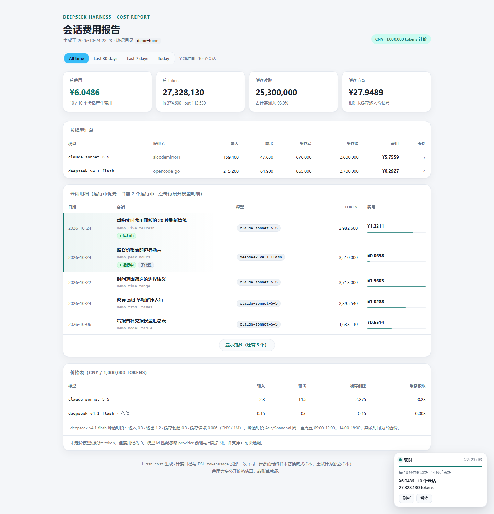
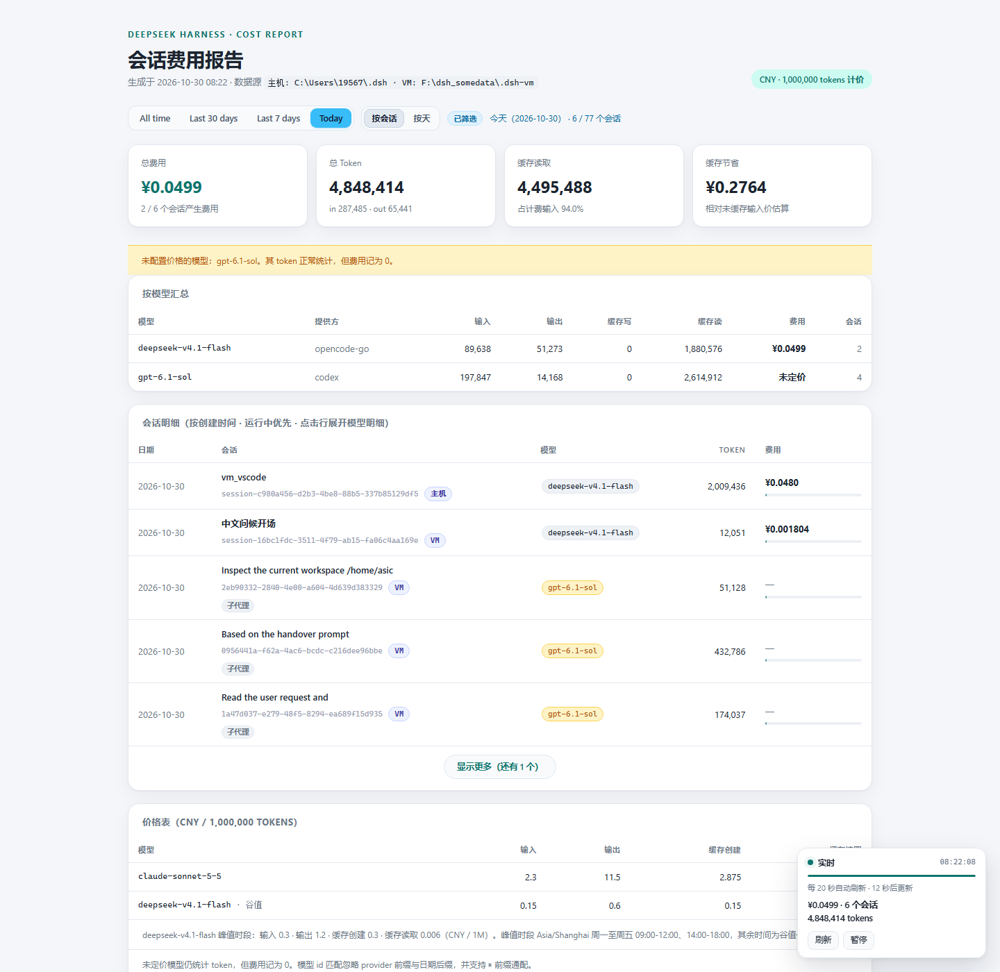
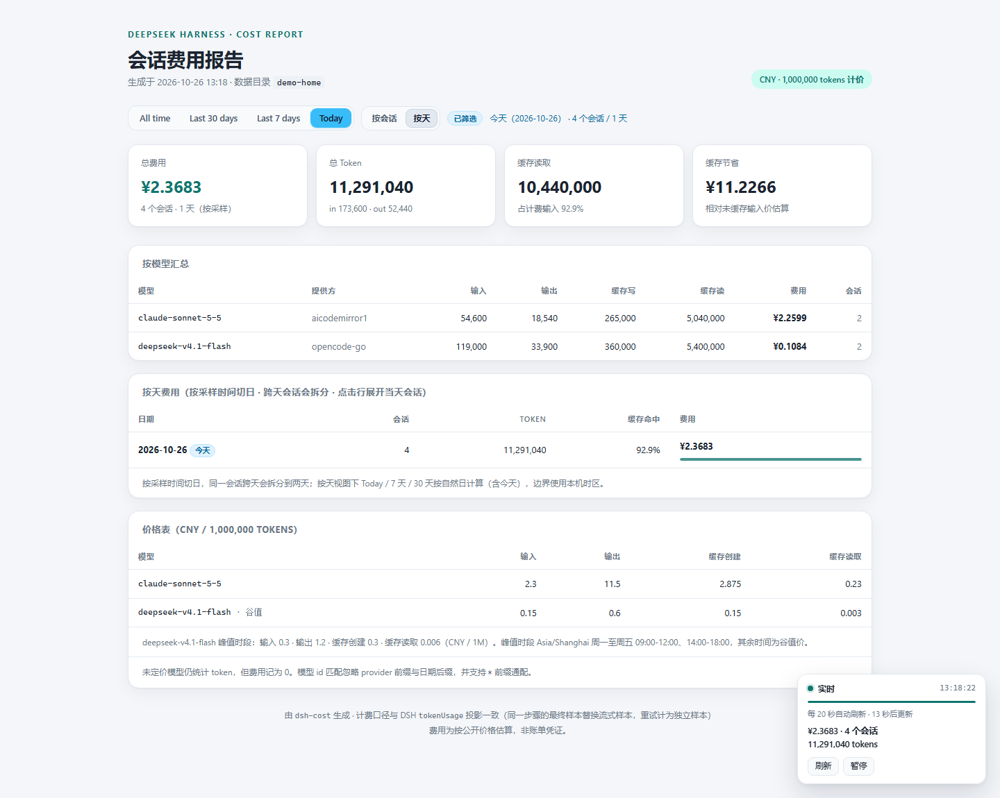

# DSH_CostLive

> A **live cost dashboard** for [DeepSeek Harness](https://github.com/deepseek-ai) (DSH) sessions:
> it re-scans the session logs every 20 seconds, prices four token buckets per model
> (uncached input / output / cache write / cache read), and shows spend, cache hit rate,
> running sessions and historical detail in the browser.
> It can run on a single machine, or keep the statistics plus the official-console sync on an
> always-on VM while the host only pushes sessions and credentials.

[](https://nodejs.org/)
[](https://github.com/4478sc/DSH_CostLive/actions/workflows/test.yml)
[](LICENSE)
[](#project-layout)



The screenshot is generated from synthetic data shipped with the repository
(`tools/make-demo-home.mjs`); it contains no real session content.

English | [简体中文](README.md)

---

## What this is

DSH writes the full event stream of every session to zstd logs under `~/.dsh/sessions/`,
but the UI only shows token totals — no money, no cross-session roll-up. This project fills
that gap:

- **Zero dependencies** — only the Node.js standard library (`node:zlib` zstd, `node:http`); no `npm install`.
- **Read-only** — it reads session logs and the projection cache; it never writes DSH data or configuration. Billing settings only write CostLive’s own local file.
- **Local** — binds to `127.0.0.1` by default, the page has no auth, and nothing is sent to external services.
- **Verifiable** — `--verify` reconciles every session against DSH's own `tokenUsage` projection; costs are
  recomputed from events, where a later sample replaces the streamed one and a retry counts as a second billed sample.

It ships a CLI (`dsh-cost`) and a local web page (`dsh-cost-live`). The page reuses the same
collect / price / render code as the report, so page numbers always match the CLI.

---

## Features

| Feature | Description |
|---|---|
| 20-second live refresh | The browser polls `/api/fragment` and replaces only the report body, so scroll position and expanded rows survive |
| Multiple sources | Scans several DSH homes at once (this machine plus a mirror pushed from another box), merges them and labels the origin |
| Four time ranges | `All time` / `Last 30 days` / `Last 7 days` / `Today`; cards, model table and detail rows recompute together and the choice is persisted |
| Per-day view | "By session / By day"; the by-day view buckets each sample by its own time, splitting midnight-crossing sessions in two, so it answers "how much did today actually cost" |
| Running first | Running main sessions → running subagents → finished (cost descending); running rows are highlighted with a pulsing label; a step with no update for 2 hours counts as abandoned (a killed DSH leaves an `openStep` behind) |
| First 5 rows | Only five rows on first paint; "show more (N left)" **reveals five more rows per click**; once expanded, a "show less" button collapses straight back to the first page (the main button also becomes "show less" when everything is visible), and the state survives refreshes and filters |
| Per-model summary | Four token buckets, cost, **average price per 1M tokens** and share per provider/model; unpriced models are flagged; two-tier models (DeepSeek) are split into peak/off-peak rows |
| Peak/off-peak pricing | `deepseek-v4.1-flash` picks its tier from **each sample's own timestamp** on weekdays, and a session that crosses the boundary is priced in two parts; summary, session detail and daily detail all show the "（峰值）/（谷值）" rows |
| Cache and unit price | Cache hit rate and cache-read volume; "Token均价" (price per million tokens) only counts priced tokens, keeps CNY and USD apart and ignores unpriced models |
| Three modes | Local HTTP server (recommended), `file:///` with a background rebuild, one-shot static snapshot |
| Read-only API | `/api/fragment`, `/api/report`, `/api/health` for scripts or other dashboards |
| Report export | HTML / JSON / CSV, terminal tables, and per-turn / per-step detail for a single session |

---

## Real price (subscription amortization)

Open "Billing settings" in the live page, choose "Real price", enter monthly OpenCode and Codex subscriptions in USD with effective dates, and save. Each provider needs at least one record; use 0 for no subscription, not a blank. The first record may start partway through a month; subsequent price changes must take effect on the first of a month. Mid-month upgrades, refunds and shifted renewal cycles are not modeled. Each rate continues until the next record; add a zero-price record at a month boundary to pause it.

- Daily fixed cost = monthly fee / actual days in that month (28/29/30/31). Today counts in full; future days do not. Rounded cumulative micro-USD day shares reconcile exactly to a full month's fee.
- Today / 7 days / 30 days / All time use **Asia/Shanghai** sample dates, not session creation dates. Days without tokens still incur subscription cost, reported as idle cost.
- Host and VM usage is combined by provider before charging each subscription once. Subscription cost replaces OpenCode/Codex console/list prices rather than adding to them. Native log tokens do not depend on timely console archives.
- Real mode reports provider totals, daily costs and effective price per million tokens, with **no model or session allocation**. The overall USD average includes idle cost and divides by four-bucket tokens in the configured USD scope; no tokens means "—". CNY/USD are never converted.
- Usage before a subscription's effective date is marked incomplete, not backfilled at the current rate. Undated tokens are disclosed separately and excluded from daily costs/averages.
- Settings live in git-ignored config/billing.local.json (personal local configuration). Export/import them in the UI; both services need identical settings and **do not sync automatically**. Deployments must preserve this file.
- The mode is saved server-side; the web page, CLI and JSON/CSV use the same calculator. JSON referenceUsage contains reference prices only and does not contribute to real totals; top-level sessions is empty because session costs are not allocated.
- An open settings editor is protected from polling fragment replacement; close it to resume. Static HTML supports viewing/export, not saving settings; edit through the live service or regenerate it.

Both CLI entry points accept --billing <file> and --billing-mode usage|real. In real mode, --since/--until select Shanghai calendar dates (YYYY-MM-DD; ISO timestamps require a zone). Partial-scope model/workspace/top/priced-only filters are rejected to avoid dividing full subscription cost by partial usage. Page export buttons export the selected range; GET /api/report and /api/report.csv export the full server range.

Settings writes require a **loopback connection**, same-origin JSON PUT /api/billing and X-CostLive-Settings: 1. LAN access is read-only: CSRF checks are not authentication. Use an SSH local port forward and localhost for remote administration; never expose the unauthenticated report service publicly. The endpoint only writes local CostLive settings, never DSH logs or credentials.

See [billing.example.json](config/billing.example.json) for an example. Example prices are not your actual subscription fees.

## Quick start

Requires **Node.js ≥ 22.15** (for `node:zlib` zstd support). No dependencies to install.

```powershell
git clone https://github.com/4478sc/DSH_CostLive.git
cd DSH_CostLive

# 1) Try it out: generate 11 synthetic sessions (written to demo-home/, delete any time)
node tools/make-demo-home.mjs
node bin/dsh-cost-live.mjs --home demo-home

# 2) Use your own data: reads $DSH_HOME, then ~/.dsh
node bin/dsh-cost-live.mjs
```

Open the address printed in the console (default <http://127.0.0.1:4173/>); `Ctrl+C` stops it.

On Windows you can also double-click:

| File | Purpose |
|---|---|
| `dsh-cost-live.cmd` | Local HTTP server (recommended, updates in place); reads `config\sources.json`, merges host + VM by default and starts / reuses both sync loops through `tools\ensure-host-sync.ps1` |
| `dsh-cost-vm-sync.cmd` | Every 20 s, incrementally sync the VM's `~/.dsh` into `.dsh-vm/` and keep the window open; the VM target comes from arguments, then `config\vm-sync.local.cmd` (git-ignored, see the `.example`), then the `DSH_COST_VM_HOST` / `DSH_COST_VM_USER` / `DSH_COST_VM_KEY` environment variables |
| `dsh-cost-live-watch.cmd` | Rebuild a standalone HTML file in the background every 20 s for `file:///` |

> macOS / Linux: same commands, replace the `.cmd` files with `node bin/dsh-cost-live.mjs`.

---

## Three run modes

| Mode | Command | Behaviour | Best for |
|---|---|---|---|
| **Local HTTP server (recommended)** | `node bin/dsh-cost-live.mjs` | The page pulls `/api/fragment` every 20 s and updates in place without losing scroll or expansion state | Leaving it open |
| **file:/// + background rebuild** | `node bin/dsh-cost-live.mjs --watch` | Atomically rewrites `out/dsh-cost-live.html` every 20 s; the page reloads itself | When only `file:///` is available |
| **One-shot snapshot** | `node bin/dsh-cost-live.mjs --once --out out/snapshot.html` | Renders a static page and exits | Archiving, sharing |

Common flags:

```powershell
node bin/dsh-cost-live.mjs --port 8080 --interval 10      # different port, 10 s refresh
node bin/dsh-cost-live.mjs --model deepseek --no-open     # DeepSeek sessions only
node bin/dsh-cost-live.mjs --top 10 --all                 # top 10 by cost (including empty sessions)
node bin/dsh-cost-live.mjs --host 0.0.0.0                 # LAN access (no auth, be careful)
```

A busy port is bumped by one automatically; `--interval` has a 5 s floor. See
[`LIVE.md`](LIVE.md) for the full option list.

---

## Split deployment: statistics on a VM, the host only pushes

The dashboard does not have to run next to DSH. Put "statistics + official sync" on an
always-on VM (or a small box) and let the host push; both machines then open the same page
through their own address:

```text
host                                            VM / small box
~/.dsh/sessions + storages/session_projcache ──20 s incremental SSH push──▶ ~/.dsh-host   ┐
~/.dsh/.credentials.yaml ──only OPENCODE_GO_API_KEY──▶ ~/.dsh-push/credentials.yaml        │
official usage archive (seeded once on first migration)──────────────▶ ~/.opencode-usage  ├─▶ scan / price / render
the VM's own ~/.dsh ───────────────────────────────────────────────────────────────────────┘   HTTP 0.0.0.0:4173
opencode.ai console ──VM polls every 60 s──▶ ~/.opencode-usage/requests.jsonl (official USD overlay)
```

- The VM runs two things: `node bin/dsh-cost-live.mjs --sources config/sources.json --host 0.0.0.0 --port 4173`
  and `node tools/opencode-sync.mjs --config config/official.json --loop`. `sources.json` points at two homes:
  `{"label": "host", "home": "~/.dsh-host"}` and `{"label": "vm", "home": "~/.dsh"}`.
- The host only pushes: session logs (Windows `tar` + `scp`, 20 s increments, only files whose mtime changed),
  a minimal credentials file containing just `OPENCODE_GO_API_KEY` (0600), and the archive seed on first migration.
  The host never reads logs, prices anything, or syncs the console.
- URLs: `http://127.0.0.1:4173/` inside the VM, `http://<vm-ip>:4173/` from the host (private network only).
- Autostart and self-healing: the VM uses cron (`@reboot` plus a 2-minute watchdog) — if `/api/health` fails it
  restarts the server, and if the archive's `lastSyncAt` is older than 15 minutes it restarts the sync loop;
  the host registers its push loop as a logon task (or you just double-click the launcher).
- The sync loop's `fetch` has a 30 s timeout, and the lock file is validated through `/proc/<pid>/cmdline` so
  "process alive but idle" and "pid reused after a restart" cannot wedge it.

> The older host-side pull mode (`tools/sync-vm-dsh.ps1` + `.dsh-vm/`) is still supported when you just want
> both machines' data on one box.

---

## Legacy mode: pull the VM's logs to the host (optional)

When the host and an Ubuntu VM each run DSH, the dashboard can read both without shipping logs
to any external service:

1. **Start the dashboard** (the launcher also starts the VM sync loop and reuses an existing one,
   so no second window is opened):

   ```powershell
   dsh-cost-live.cmd
   # or: node bin\dsh-cost-live.mjs --sources config\sources.json
   ```

   A sync window appears next to it and pulls the VM's `~/.dsh` every 20 s. It is independent of the
   dashboard window: closing the dashboard leaves it running, and you can reopen it on demand:

   ```powershell
   dsh-cost-vm-sync.cmd
   # once: powershell -ExecutionPolicy Bypass -File tools\sync-vm-dsh.ps1
   ```

`config/sources.json` defines the sources; `home` accepts `~` and relative paths (relative to that JSON file):



```json
{
  "sources": [
    { "label": "host", "home": "~/.dsh" },
    { "label": "VM", "home": "../../.dsh-vm" }
  ]
}
```

- Only `sessions/` and `storages/session_projcache/` are copied, incrementally; the mirror defaults to
  `.dsh-vm/`, which is already in `.gitignore`.
- When the VM is off the sync script skips the round and retries every 60 s; the dashboard keeps showing host
  data and flags "source unavailable" at the top.
- Session rows carry a "host / VM" label; cards, the model summary, session counts and the daily view are
  merged across both sides.
- The CLI supports it too: `node bin\dsh-cost.mjs --sources config\sources.json`, or
  `--source host=~/.dsh --source VM=F:\...\.dsh-vm` for an ad-hoc run.
- The VM address, user, private key and remote DSH directory are parameters of `tools/sync-vm-dsh.ps1`
  (`-VmHost` is required, the rest have defaults).

---

## Official usage: the OpenCode console log (opencode-go)

When DSH runs through `opencode-go`, local logs can only estimate tokens — the real bill lives in the
OpenCode console (`opencode.ai/console`). The dashboard prefers the console numbers by default and keeps
the local estimate only as a backup:

- **Official API**: `GET https://opencode.ai/console/api/request-logs?category=inference`; every row carries
  `sessionID` (the upstream `x-opencode-session`), `inputTokens / outputTokens / cacheReadTokens / cacheWriteTokens`
  and `cost` (USD), so rows map onto DSH sessions exactly.
- **The upstream keeps 30 days**: the response's `retentionDays` is the retention. `tools/opencode-sync.mjs`
  pulls incrementally every 60 s and appends to `.opencode-usage/requests.jsonl` (append-only, de-duplicated by
  request `id`), so the full history survives locally.
- **Strictly official billing**: `opencode` / `opencode-go` sessions are billed **only** from the console;
  the CNY table in `config/pricing.json` does not participate at all (see `OFFICIAL_PROVIDERS` in
  `src/pricing.mjs`). With official rows the session is replaced wholesale in USD
  (`priceKey = opencode-official`, cost = official `cost`, never converted); without them the row shows
  "pending console" and costs 0 — it **never** falls back to a CNY estimate; once the sync catches up it
  turns into a `$` amount. Sessions that mix other providers keep their local CNY numbers and are never
  half-overwritten.
- **opencode and opencode-go are one service**: DSH records whichever route the request took, but the models
  and the bill are identical, so the model summary, session detail and daily detail fold both into a single
  `opencode` row (`canonicalProvider` in `src/pricing.mjs`).
- **Page hints**: the header shows "official usage: N sessions…" for the covered ones and "pending console:
  N sessions…" for opencode sessions with no archived request yet. The CLI's COST column and model detail show
  the same "pending console" marker.
- **Two currencies, never converted**: official costs stay in USD (`costMicroUsd`), the local table stays in CNY;
  sessions, models, days and totals all carry both and render as `￥N1+$N2`, summing only within a currency.
  Ordering alone uses a fixed constant to put both in one queue (`SORT_USD_TO_CNY`, never part of a sum).
- **Console cross-check**: the sync also records the console's `/usage/cost-by-day` (UTC days) and the page
  shows "official (UTC day): today / 7 days / 30 days". The dashboard itself splits by **local time zone**, eight
  hours away from the console window — the gap is most visible on short windows like 7 days, and these two lines
  explain it.
- **Official cache saving in USD**: `usdRates` in `config/official.json` (USD per 1M tokens fitted to the official
  bill) is used only for "how much the cache saved": `cacheReadTokens × (input − cacheRead)`. A missing model
  scores 0; the CNY table is never applied to official sessions.
- **Config** `config/official.json`: `store` (archive directory), `providers`, and `credentials`
  (`OPENCODE_GO_API_KEY` from `~/.dsh/.credentials.yaml` by default; an environment variable of the same name wins).

```powershell
node tools\opencode-sync.mjs --stats     # archive overview: rows, sessions, time range, USD total
node tools\opencode-sync.mjs             # one incremental sync
node tools\opencode-sync.mjs --loop      # sync every 60 s; dsh-cost-live.cmd starts it automatically
node bin\dsh-cost.mjs --no-official      # ignore the archive for a run (opencode stays "pending", never CNY)
```

`dsh-cost-live.cmd` calls `tools\ensure-host-sync.ps1`, which starts both background loops — the VM mirror
and the OpenCode log sync — and reuses whichever is already running (lock files `out\vm-sync.pid` /
`out\opencode-sync.pid`).

`tools\ensure-host-sync.ps1` is idempotent: run it by hand or schedule it to heal a loop that died (a dead loop
comes back within one period; an archive that has not moved for 10 minutes gets a WARN in `out\ensure-sync.log`):

```bat
schtasks /Create /TN DSH_CostLive_SyncKeepAlive /SC MINUTE /MO 5 /F ^
  /TR "powershell -NoProfile -ExecutionPolicy Bypass -WindowStyle Hidden -File <repo>\tools\ensure-host-sync.ps1"
```

---

## Using the page

- **Time range**: four buttons at the top. Switching recomputes the four cards and the model summary, and
  re-paginates the **filtered** detail list; a historical session without `createdAt` is never hidden
  (better to show more than to hide real spend).
- **By session / By day**: a view toggle at the top. By session filters whole sessions by `createdAt`; by day
  buckets each **sample time** into a local calendar day, so one session can appear on two days, and cards plus
  the model table switch to sample totals — this answers "how much did today actually cost". In the by-day view
  Today / 7 days / 30 days are calendar days (including today) in the local time zone.
- **English UI**: use the “中文” / “English” link in the page header, or add `?lang=en` to the URL; the server also honours the browser's `Accept-Language`. All 界面 strings live in `src/i18n.mjs`, and the two dictionaries must stay identical (`npm run check:i18n`).
- **Daily folding**: the by-day table shows the latest seven days first; older days sit behind a “Show more (N more days)” button that **reveals seven more days per click**, and a “Show less” button collapses straight back to the latest week at any time; the state survives refreshes and view switches.
- **Session detail**: five rows by default. Click any row to expand its per-model detail, per-turn subtotals and
  every billed sample.
- **Bottom-right panel**: connection state, data timestamp, countdown to the next refresh, total cost / sessions /
  tokens; buttons "Refresh / Pause", shortcuts **R** to refresh and **P** to pause. The countdown pauses while the
  tab is in the background.
- **Status meanings**: green "live", grey "paused", red "disconnected", amber "snapshot not updated".
- Below 820 px the time-range bar is hidden; below 640 px the panel goes full width.

---

## Data and pricing

### Where the data comes from

```text
~/.dsh/sessions/<encoded workspace>/<session-id>/session.v4.jsonl.zstd
        │  multi-frame zstd (one frame per append) → frame-by-frame decompress → JSONL events
        ▼
session header / session/title / request.header / assistant.message / llm.retry-started ...
        │  fold: a later sample of the same step replaces the streamed one; a retry is billed separately
        ▼
four token buckets + per-sample provider/model/time → priced by the model table (micro-CNY, rounded)
```

- DSH data directory precedence: `--sources` / `--source` → `--home` → `$DSH_HOME` → `~/.dsh`; with several
  sources every session carries its origin label.
- A subagent is a separate session (own log, own invoice); the page labels it "subagent" and sorts it after its
  parent session.
- The projection cache `~/.dsh/storages/session_projcache/sessions/<id>.json` is only used for run state, titles
  and `--verify`; amounts are always recomputed from the log.

### The by-day cost view

Both the HTML report and the live page offer the "by session / by day" toggle (stored in
`localStorage["dsh-cost-view"]`):



- **By session** (default): sessions fall into the range by `createdAt` and each row shows its full cost;
  running sessions sort first.
- **By day**: every billed sample is placed on a local calendar day by **its own `event.time`**; a session that
  crosses midnight appears on two days, each carrying only that day's tokens and cost. The cards ("total cost /
  total tokens / cache read / price per million tokens") and the model summary switch to the same sample totals,
  so `Today` really is "how much today cost".
- Ranges in the by-day view are calendar days: Today = today, 7 days = today plus the previous six, and so on;
  boundaries follow the local time zone. Samples without a timestamp only appear in the "unknown date" row under
  All time and are never silently dropped.
- The daily buckets always add up to the session totals: splitting changes no amount and double-bills nothing.

### Price table

The default table lives in [`config/pricing.json`](config/pricing.json) in **CNY per 1,000,000 tokens**.
It only estimates CNY for **non**-opencode providers (for example claude on `aicodemirror1`);
`opencode` / `opencode-go` are always billed in USD from the console, as described above:

| Model | Input (uncached) | Output | Cache write | Cache read |
|---|---:|---:|---:|---:|
| `claude-sonnet-5-5` | 2.3 | 11.5 | 2.875 | 0.23 |
| `deepseek-v4.1-flash` (off-peak) | 0.15 | 0.6 | 0.15 | 0.003 |
| `deepseek-v4.1-flash` (peak) | 0.3 | 1.2 | 0.3 | 0.006 |

```text
cost = (uncached input × input + output × output + cache write × cacheWrite + cache read × cacheRead) / 1e6
```

- The two-tier tariff is selected by **each sample's own timestamp**, and a session that crosses the boundary is
  priced in two parts; a sample without a timestamp takes the off-peak rate (never inflated).
- Default peak windows: `Asia/Shanghai`, Monday to Friday, `[09:00,12:00)` and `[14:00,18:00)` (left-closed,
  right-open); weekends and the dates in `peakHours.holidays` are priced off-peak.
- For DeepSeek `cacheWrite` equals `input` (a reported cache write is charged as an uncached input); models such
  as `deepseek-v4.1-flash` have **no cache write**, so `cacheWriteTokens` is always 0, that term is multiplied by
  zero and never double-counts the input.
- Unpriced models still contribute tokens with a zero cost and are listed at the top of the page and in
  `unpricedModels` in the JSON.
- Costs are **estimates from configured unit prices** — no batch discounts, tier pricing or refunds — and are not
  an invoice.

Custom tables: edit `config/pricing.json`, or pass `--pricing my-pricing.json`. Model lookup goes exact id →
strip provider prefix → strip date suffix → alias → longest `*` prefix. Adding a model is one entry in
`models`; no code change.

### USD price table (providers billed in dollars, e.g. codex)

Some providers are billed from the OpenAI API list price in USD, for example `codex`. They are configured in
[`config/usd-pricing.json`](config/usd-pricing.json) in **USD per 1,000,000 tokens**:

| Model | Input (uncached) | Output | Cache write | Cache read |
|---|---:|---:|---:|---:|
| `gpt-6.1-sol` | 2 | 10 | 2.5 | 0.1 |
| `gpt-6-luna` | 0.1 | 0.5 | 0.125 | 0.01 |

- `providers` lists the providers covered by this table; matching rows record USD only (`costMicroCny` stays 0)
  and use `priceKey = usd-<model>`, so they join the USD side of "Token均价" just like CNY rows do on theirs.
- Several routes of the same service fold into one row: `codex` / `openai` / `host-codex` → `codex`,
  `opencode` / `opencode-go` → `opencode` (`canonicalProvider` in `src/pricing.mjs`).
- The long-context surcharge from the official price list (2× input / 1.5× output above 272k prompt tokens) is
  not modelled.
- Custom table: `--usd my-usd-pricing.json`; a missing file simply means "no USD table" and is not an error.

---

## API

Server mode exposes three read-only endpoints:

| Path | Content |
|---|---|
| `GET /api/fragment` | Latest report HTML fragment plus `generatedAt` / `summary` / `intervalMs` / `stale` |
| `GET /api/report` | The same full JSON as `dsh-cost report --format json` |
| `GET /api/health` | Liveness, scan count, duration, last error and the current summary |

```powershell
Invoke-RestMethod http://127.0.0.1:4173/api/health | Format-List
(Invoke-RestMethod http://127.0.0.1:4173/api/report).summary
```

---

## Command line (same core)

```powershell
node bin/dsh-cost.mjs                              # session overview
node bin/dsh-cost.mjs models                       # print the price table (tiers and aliases included)
node bin/dsh-cost.mjs session <id|prefix> --steps    # one session in detail
node bin/dsh-cost.mjs --model deepseek             # filter by model
node bin/dsh-cost.mjs --since 2026-10-01 --priced-only
node bin/dsh-cost.mjs report --format html --out out/report.html
node bin/dsh-cost.mjs report --format csv  --out out/report.csv
node bin/dsh-cost.mjs --json                       # machine readable
node bin/dsh-cost.mjs --verify                     # reconcile against DSH's tokenUsage projection
```

| Option | Meaning |
|---|---|
| `--home <dir>` / `--pricing <file>` | Single data directory / custom price table |
| `--source <label=dir>` / `--sources <file>` | Add a source (repeatable) / read several sources from JSON |
| `--workspace <text>` / `--model <text>` | Filter by workspace directory name / model substring |
| `--since` / `--until` | Session creation range (`YYYY-MM-DD` or ISO) |
| `--top <n>` / `--priced-only` / `--all` | Top N by cost / billed sessions only / include empty sessions |
| `--format table\|json\|csv\|html` / `--out` | Output format and destination |
| `--verify` / `--verbose` | Projection check / warnings on stderr |

Exit codes: `0` success, `1` no data or runtime failure, `2` bad arguments.

---

## Project layout

```text
DSH_CostLive/
├─ bin/
│  ├─ dsh-cost.mjs            # CLI entry point
│  └─ dsh-cost-live.mjs       # live dashboard entry (server / --watch / --once)
├─ config/pricing.json        # price table (off-peak / peak / aliases)
├─ config/sources.json        # sources: host ~/.dsh + VM mirror .dsh-vm
├─ src/
│  ├─ pricing.mjs             # table normalization, model matching, peak tiers, micro-CNY arithmetic
│  ├─ engine.mjs              # event fold → billed samples and four-bucket aggregation
│  ├─ sessions.mjs            # session discovery, log reading, projection cache
│  ├─ sources.mjs             # host/VM source resolution and labels
│  ├─ zstd.mjs                # multi-frame zstd decompress (Node only decodes the first frame)
│  ├─ activity.mjs            # running / subagent detection and ordering
│  ├─ time-range.mjs          # four ranges + by-day runtime (shared by Node and the page)
│  ├─ report-data.mjs         # session records, daily aggregation, dataset, CSV
│  ├─ report-text.mjs         # terminal tables / detail / price list
│  ├─ report-html.mjs         # self-contained HTML report (inlined CSS/JS)
│  ├─ live.mjs                # live document / fragment / atomic write
│  ├─ live-server.mjs         # local HTTP server and the three APIs
│  └─ live-client.js          # browser side: polling, folding, ranges, scroll restore
├─ test/                      # node:test, 9 files, 64 cases
├─ tools/make-demo-home.mjs   # synthetic demo data generator
├─ tools/sync-vm-dsh.ps1      # incremental ~/.dsh → .dsh-vm sync from a VMware VM
├─ tools/vm-sync-snapshot.sh  # VM-side incremental packer
├─ docs/                      # architecture, DSH token accounting research, development notes
├─ assets/preview*.png        # screenshots (session view / by-day view, demo data)
├─ LIVE.md                    # complete live-dashboard guide
├─ tools/ensure-host-sync.ps1 # idempotent watchdog for both sync loops (pid lock + heartbeat)
├─ dsh-cost-live.cmd          # Windows launcher: HTTP server (host + VM) and sync startup
├─ dsh-cost-vm-sync.cmd       # Windows launcher: continuous VM data sync
└─ dsh-cost-live-watch.cmd    # Windows launcher: background HTML rebuild
```

There are no runtime dependencies, so there is no `package-lock.json` and no `node_modules`.

---

## Tests

```powershell
npm test
```

| File | Cases | Coverage |
|---|---:|---|
| `pricing.test.mjs` | 11 | Table normalization, aliases, wildcards, peak tiers, micro-CNY precision, built-in table parity |
| `engine.test.mjs` | 9 | Streaming replacement, retries, four-bucket merge, zero usage, model switches, opencode pending |
| `activity.test.mjs` | 7 | `openStep` authority, `turnBoundary` fallback, dual-channel subagent detection, stable three-bucket ordering |
| `time-range.test.mjs` | 18 | Range boundaries, missing dates, aggregation arithmetic, browser runtime, DOM events, storage fallbacks, HTML integration |
| `daily.test.mjs` | 7 | Midnight split, unknown-time bucket, calendar boundaries, daily de-duplication, by-day DOM and storage |
| `live.test.mjs` | 6 | Collection/filtering, template splitting, atomic writes, HTTP API |
| `opencode-usage.test.mjs` | 13 | Official row normalization, de-duplication, session overlay, window totals, cache saving |
| `sources.test.mjs` | 3 | Multi-source parsing, host+VM merge, degraded missing source |
| `sessions.test.mjs` | 2 | Session discovery and reading |
| `zstd.test.mjs` | 2 | Multi-frame decompression, plain JSONL fallback |
| **Total** | **78** | |

CI runs the same suite on Node 22 and Node 24 (`.github/workflows/test.yml`). Node 22 still calls the test
isolation switch `--experimental-test-isolation`, so that job uses `npm run test:node22`.

---

## Development and maintenance

- README changes: `npm run check:readme` verifies that `README.md` and `README.en.md` have the same sections, code blocks, tables and images; CI runs it too.
- Price changes: only `config/pricing.json` (peak windows included); run `npm test` afterwards.
- Range semantics or boundaries: only `src/time-range.mjs` — Node tests and the browser share one source, so
  server and client can never drift apart.
- Page styling: `src/report-html.mjs` (report) and `LIVE_CSS` / `live-client.js` in `src/live.mjs` (the panel).
- Two hard rules: **filter first, paginate second**; **pick the tier per sample**.
- Module responsibilities, data flow and extension points: [`docs/ARCHITECTURE.md`](docs/ARCHITECTURE.md);
  DSH token accounting: [`docs/DSH-TOKEN-ACCOUNTING.md`](docs/DSH-TOKEN-ACCOUNTING.md);
  pitfalls and debugging commands: [`docs/DEVELOPMENT.md`](docs/DEVELOPMENT.md).

---

## Privacy and security

- Reads local files only; the server binds to `127.0.0.1` by default, serves a page and JSON, and never executes
  anything from a request.
- The page shows session titles and workspace paths. With `--host 0.0.0.0` there is **no authentication**, so keep
  it on a trusted network.
- `demo-home/` and `out/` are generated and git-ignored; never commit real session logs or reports.
- The VM mirror copies only `sessions/` and `storages/session_projcache/` — no credential files such as
  `.credentials.yaml`; `.dsh-vm/` is git-ignored as well.

---

## FAQ

| Symptom | Fix |
|---|---|
| The window flashes and closes / "Node not found" | Install Node.js ≥ 22.15 and check `node -v` |
| Page shows "disconnected" | The server stopped; start it again and reload |
| Page shows "paused / snapshot not updated" | The background rebuild is not running; start `dsh-cost-live-watch.cmd` or press "Resume" in the panel |
| 0 sessions | Check that `--home` / `$DSH_HOME` / `~/.dsh/sessions` contains `session.v4.jsonl.zstd` files |
| Amounts differ from DSH | Run `node bin/dsh-cost.mjs --verify`; a running session's projection may lag, retry later |
| Peak price not applied | Use `--since` to check whether the samples fall inside a weekday peak window; 12:00 and 18:00 sharp are already off-peak |

More troubleshooting in [`LIVE.md`](LIVE.md).

---

## Documentation index

| Document | Content |
|---|---|
| [`LIVE.md`](LIVE.md) | Live dashboard: three modes, page behaviour, API, every flag, troubleshooting, security |
| [`docs/ARCHITECTURE.md`](docs/ARCHITECTURE.md) | Data flow, module responsibilities, invariants, extension points |
| [`docs/DSH-TOKEN-ACCOUNTING.md`](docs/DSH-TOKEN-ACCOUNTING.md) | How DSH counts tokens (events, projections, replacement/retry rules) |
| [`docs/DEVELOPMENT.md`](docs/DEVELOPMENT.md) | Development notes: pitfalls, debugging commands, acceptance checklist, ideas |

---

## License

[MIT](LICENSE) © 2026 4478sc
